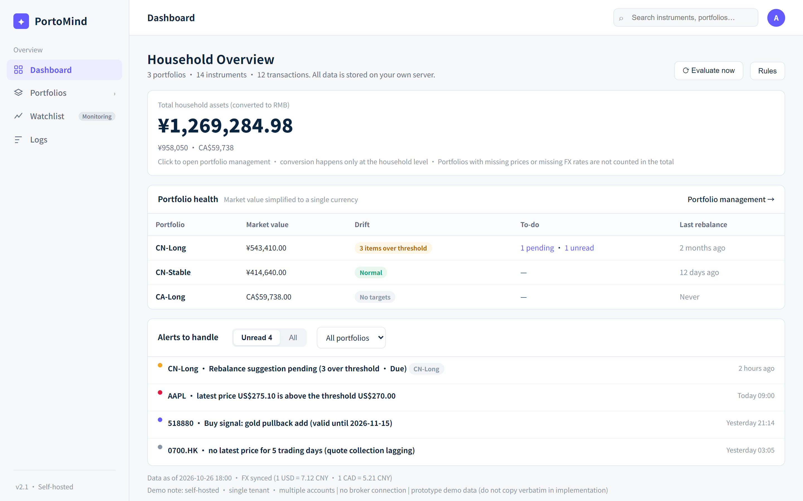
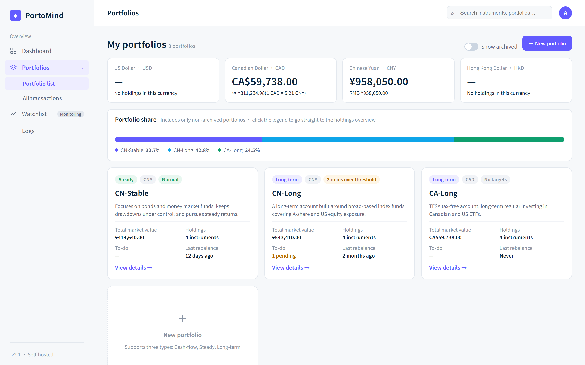
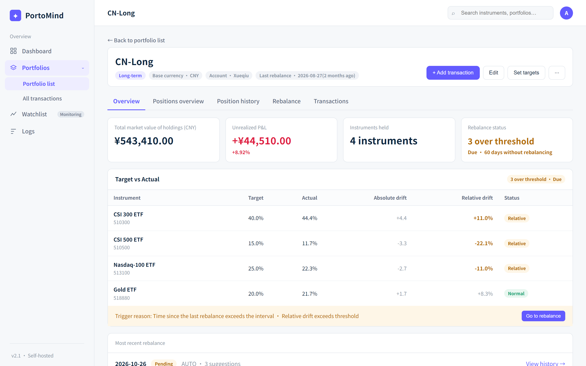
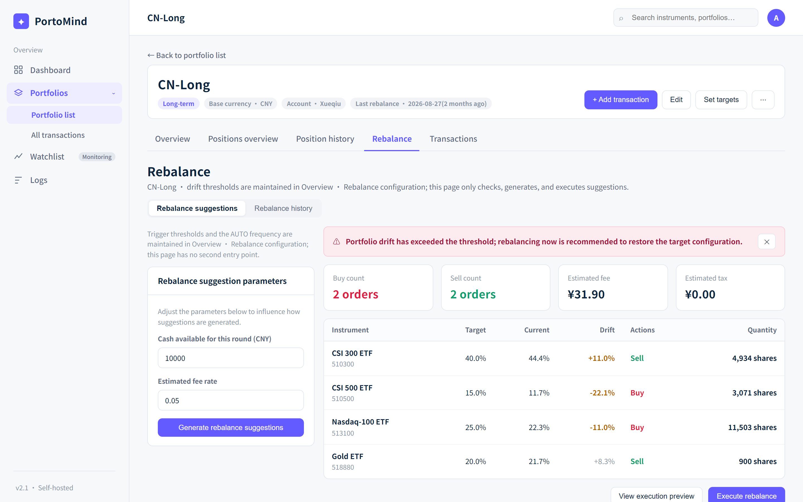
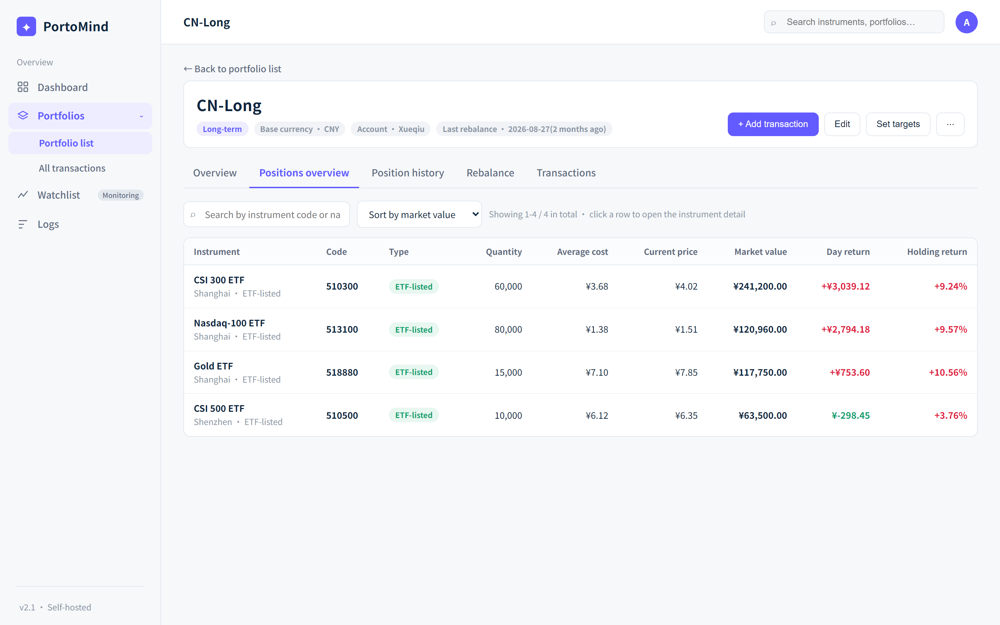
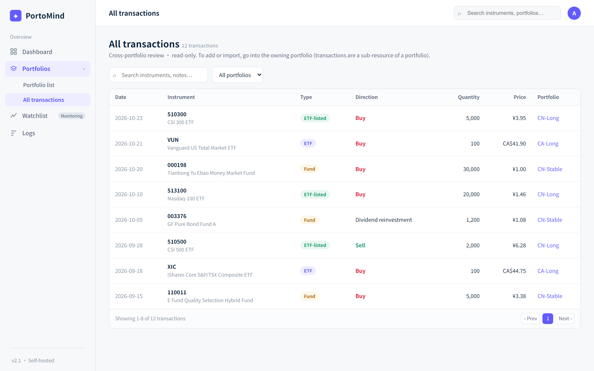
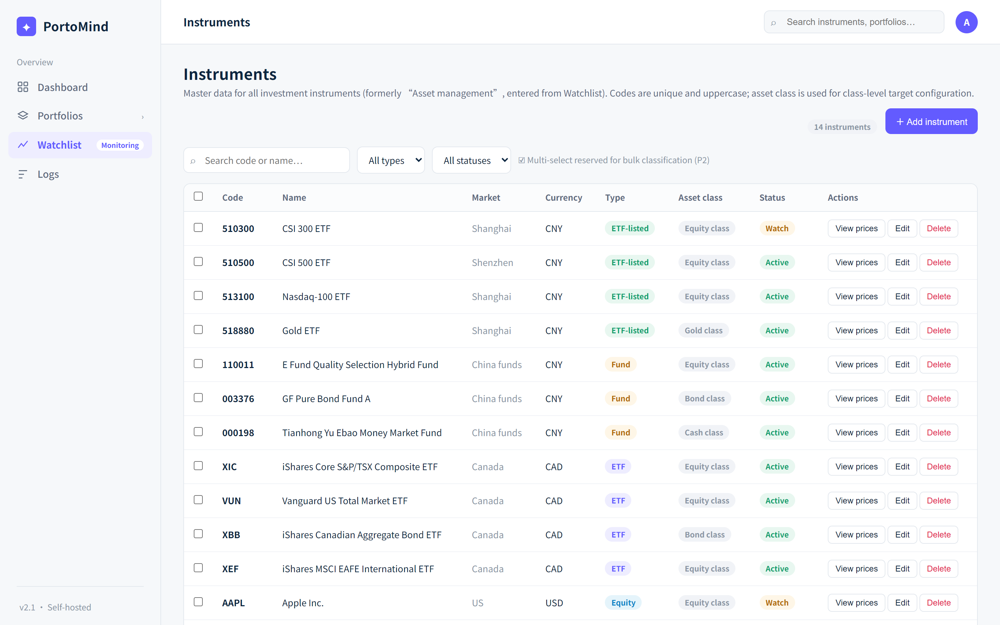
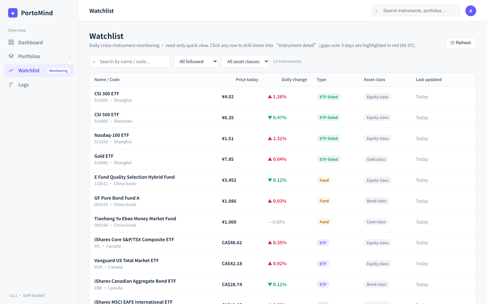

# PortoMind

> Self-hosted, single-family investment portfolio manager — ledger, multi-market quotes, target allocation, rebalancing advice, and cross-currency household roll-up. Runs locally; built as a clean modular monorepo.


PortoMind turns "what did I buy / what is it worth now / how far am I from target / should I rebalance" — normally scattered across spreadsheets, broker apps, and quote websites — into **one local system that updates itself every day, with a single source of truth and drill-down from household → portfolio → position → instrument**.

- 🇨🇳 **中文说明**：[docs/README.zh-CN.md](./docs/README.zh-CN.md)
- 📚 **Full documentation index**：[docs/readme.md](./docs/readme.md)

---

## ✨ Highlights for engineers

> TL;DR of what this project demonstrates technically.

- **Modular monorepo (npm workspaces)** — one shared business kernel (`shared/`) and three thin shells: a React SPA, a REST API, and a scheduler worker. Business rules live in exactly **one** place.
- **Clean architecture boundaries** — strict dependency direction; the API process holds **zero** cron jobs, the worker holds **zero** business rules, the client does **zero** financial math.
- **Single-scheduler decision (ADR-002)** — all 5 scheduled jobs live only in `cron-worker`; manual and automatic triggers share the *same* function, so behavior never drifts.
- **Fault-tolerant market-data ingestion** — unified timeout + retry + error-normalization layer, per-market source routing (US/CA/HK, A-shares, CN mutual funds, FX), per-asset failure isolation.
- **"Don't guess when data is missing"** — missing prices/rates surface as `null`, never `0`; the whole chain degrades to an honest "—" instead of a wrong number.
- **Observable scheduling** — every run is a `TaskRun` record (dedup + status); a read-only aggregate endpoint exposes run health; structured logs are shared across processes.
- **Engineered, not just coded** — Conventional Commits + PR workflow, ADRs, testing standards, and a "docs-as-code" single-ownership documentation system.

---

## 📌 What it does

PortoMind is a **family ETF / fund / stock portfolio ledger + decision assistant**. Three independent portfolios (CN-稳钱 / CN-长钱 / CA-长钱) sit under one household-level RMB view.

| It **is** | It is **not** |
|---|---|
| A family portfolio ledger | A broker or order gateway |
| A target-vs-actual allocation monitor | A budgeting / expense app |
| A rebalancing *advisor* (sell-then-buy list) | An auto-trading bot (AUTO only advises) |
| An in-app alert center (due / drift / valuation) | A multi-user SaaS (no auth yet, LAN-only) |
| A household RMB roll-up layer | A quote terminal |

Three non-negotiable product boundaries shape the architecture:

1. **Never places an order** — AUTO rebalancing only produces advice + alerts; execution is always a human click.
2. **Never guesses a missing price** — valuation fields are `null`, never `0`.
3. **Only converts currency at the household layer** — portfolios never cross-sum currencies; FX and price are equally trusted prerequisites.

---

## 🧩 Feature map

Features are organized into 7 product lines, evaluated against three value pillars: *remember accurately* · *see clearly* · *act correctly*.

| Area | Capability |
|---|---|
| **Ledger (PL-1)** | Asset CRUD, transaction CRUD (buy / sell / cash-dividend / reinvest), moving-average-cost position engine, **CSV batch import**, short-sell / over-sell guards |
| **Market data (PL-2)** | Daily idempotent price sync across Yahoo / Eastmoney / TianTianFund, historical price query, integrity check with auto back-fill, valuation percentile |
| **Portfolio & allocation (PL-3)** | Per-portfolio target config (asset- or class-level), overview & history, drift visibility, archive |
| **Rebalancing (PL-4)** | Absolute + relative drift + time-interval triggers → sell-then-buy suggestion → confirm → internal transaction with **undo/redo**; AUTO mode advises only |
| **Alerting (PL-5)** | 8 rule types (price / P&L / drift / 52-week high-low / valuation / manual), daily batch → in-app events |
| **Household (PL-6)** | RMB household total, CNY/USD/CAD/HKD buckets, per-portfolio contribution, recent activity (auto FX + manual fallback) |
| **Platform (PL-0)** | Single scheduler, data-quality programs, observability, design-system consistency |

## 🖼 The product at a glance



*Household total assets, per-portfolio health table (issues sorted to the top), and the live alert feed.*

### Portfolios & allocation



*Each portfolio as a card with a drift badge, market value, pending actions, and last-rebalance date.*

### Rebalancing




*Overview KPIs + target-vs-actual, then a sell-then-buy suggestion you confirm (never auto-executed).*

### Ledger




*Holdings table and the cross-portfolio transaction ledger (CSV batch import supported).*

### Market data




*Instrument master (asset metadata) and price history — the single source of truth feeding every upstream view.*

---

## 🛠 Tech stack

| Layer | Technology |
|---|---|
| **Frontend** | React 19 · Vite 6 · React Router 7 · TanStack Query 5 · Recharts · Tailwind CSS 4 · lucide-react |
| **Shared kernel** | Node.js (CommonJS) · Mongoose 6 · axios · dayjs · winston (+ daily-rotate-file) |
| **API** | Node.js · Express 4 · cors · express-async-handler · uuid · dotenv |
| **Scheduler** | Node.js (CommonJS) · node-cron 4 · p-limit · minimist · dotenv |
| **Persistence** | MongoDB (single instance; shared by API + worker; Mongoose ODM) |
| **Packaging** | npm workspaces (4 packages: `shared` / `server` / `cron-worker` / `client`) |
| **Testing** | Node.js built-in `node --test` — 19 HTTP integration tests (`server`) + 11 unit/scheduler tests (`cron-worker`) |

---

## 🏛 Architecture

A **modular monolith**: one shared business kernel, three processes that only *trigger* or *serve*, never own business logic.

```text
        ┌─────────────┐
        │   client    │  React SPA (presentation + interaction only)
        │   (Vite)    │
        └──────┬──────┘
               │  HTTP (axios)
               ▼
        ┌─────────────┐         ┌──────────────────────┐
        │   server    │  REST   │     cron-worker       │  scheduler (no port)
        │  (Express)  │◄────────┤  node-cron · 5 jobs   │
        └──────┬──────┘  shared │  (trigger rights only)│
               │       DB/logs  └──────────┬───────────┘
               ▼                          ▼
        ┌──────────────────────────────────────────────┐
        │        @portomind/shared  (the one kernel)     │
        │  models · services · tasks · fetchers · utils  │
        └──────────────────────────┬───────────────────┘
                                   ▼
                          ┌──────────────┐
                          │   MongoDB    │   single source of truth
                          └──────────────┘
```

**Dependency direction (enforced):**

```text
client ──HTTP──> server ──┐
                          ├──> @portomind/shared ──> MongoDB
cron-worker ──────────────┘
```

- `client` talks to `server` only over HTTP; never touches the DB or `shared`.
- `server` and `cron-worker` are mutually unaware — they collaborate only through the shared DB and `shared/`.
- `shared` has **zero** reverse references to any shell (no `process.exit`, no CLI args, no signals).
- Cross-package imports use the package alias `@portomind/shared/...`, never relative path traversal.

**External integrations (all outbound, read-only):**

| Source | Markets | Purpose |
|---|---|---|
| Yahoo Finance | US / CA (`.TO`) / HK (`.HK`) | Quotes |
| Eastmoney | A-shares (`CN-SH` / `CN-SZ`) | Quotes + K-line history |
| TianTianFund | CN mutual funds (`CN-FUND`) | Net asset values |
| er-api | USD / CAD / HKD → CNY | FX rates |

---

## ⚙️ Engineering practices

These are the things that make the codebase maintainable as a long-lived personal project, and the parts worth highlighting in a review:

- **Single source of truth** — all business rules, models, and fetchers exist *once* in `shared/`; both backends load the same code. Duplicating a rule is treated as a defect.
- **Decision records (ADR)** — structural choices (e.g., single scheduler) are written down before code changes, not after.
- **Observability by design** — scheduling is deduped and status-tracked via `TaskRun`; logs are shared across processes; a read-only endpoint exposes run health.
- **Fault tolerance as a library** — one timeout/retry/error-normalization layer wraps every external call; per-asset failures are isolated so one bad symbol can't sink a sync.
- **Tests that prove behavior** — HTTP integration tests for the API, unit/scheduler tests for the worker, following a written testing standard (behavior over implementation, risk-based depth, regression tests for bugs).
- **Conventional Commits + PR workflow** — `feat(scope):` / `docs(...)` / `feat(TASK-054):` style commits on `feature/TASK-xxx` branches, merged via pull requests.
- **Docs-as-code** — documentation follows a single-ownership rule (each topic described in exactly one place, cross-linked otherwise) so it stays consistent as the code evolves.

---

## 🚀 Quick start

Requires **Node.js 24**, **npm**, and **MongoDB**.

```bash
cp server/.env.example server/.env
cp client/.env.example  client/.env
cp cron-worker/.env.example cron-worker/.env

npm ci                                      # install all workspaces once
npm run seed:baseline --workspace server    # load baseline data
npm run dev:server                          # API on :8080
npm run dev:client                          # SPA on :5173
npm run dev:worker                          # scheduler (optional)
```

Verify:

```bash
npm test                  # all workspaces
npm run test:server
npm run test:worker
```

Full setup, production deployment (PM2 + Nginx), the full environment-variable table, and security notes are in the [System Deployment Manual](./docs/manual/DEPLOYMENT.md).

---

## 📊 Status & roadmap

**Solid today:** the full ledger → cost engine → allocation → rebalancing → alerting → household roll-up loop is functional; multi-market data ingestion and data-quality programs are in place; the codebase is architecturally disciplined.

**Known gaps (called out honestly, not hidden):**

- No authentication / authorization yet — the API is intended for a trusted LAN only (CORS is currently open; tightening is a pre-public prerequisite).
- No database transactions / TTL / migration framework — cross-collection writes rely on service-layer ordering and idempotency keys.
- FX collection direction bug and `symbol` normalization are tracked tech-debt items.

**Next (priority order):** fix the trust baseline (auth + CORS), close the last mile of the decision loop (batch import undo, data-quality dashboard), then experience polish. Detailed evaluation is in [PRODUCT_LINES.md](./docs/product/PRODUCT_LINES.md).

---

## 📚 Documentation

| Doc | Audience |
|---|---|
| [Documentation index](./docs/readme.md) | Entry point to everything |
| [Client manual](./docs/manual/CLIENT.md) | How to use the UI |
| [Server manual](./docs/manual/SERVER.md) | API process, manual endpoints |
| [cron-worker (overview / ops / product / dev)](./docs/manual/CRON_WORKER.md) | Scheduler from three viewpoints |
| [Deployment manual](./docs/manual/DEPLOYMENT.md) | Local dev, prod, env vars, security |
| [Architecture](./docs/architecture/ARCHITECTURE.md) | Stack, boundaries, data flow, ADRs |
| [API contract](./docs/dev/API_CONTRACT.md) · [Data model](./docs/dev/DATA_MODEL.md) · [Client dev](./docs/dev/CLIENT_DEV.md) | Developer references |
| [Product lines](./docs/product/PRODUCT_LINES.md) | Feature panorama & roadmap |

---

## 📄 License

Released under the [MIT License](./LICENSE).

---

<p align="center">
  🇨🇳 中文版说明见 <a href="./docs/README.zh-CN.md">docs/README.zh-CN.md</a>
</p>
